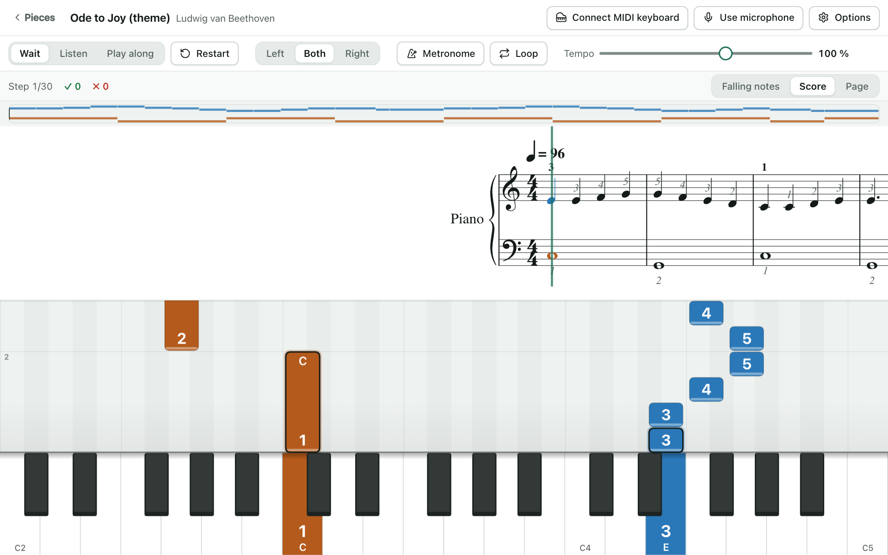
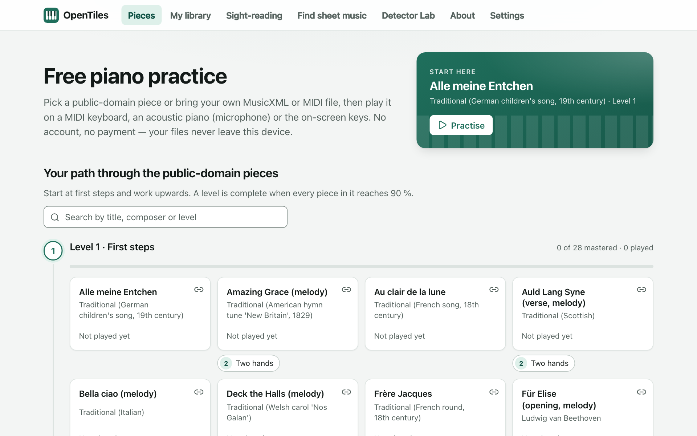
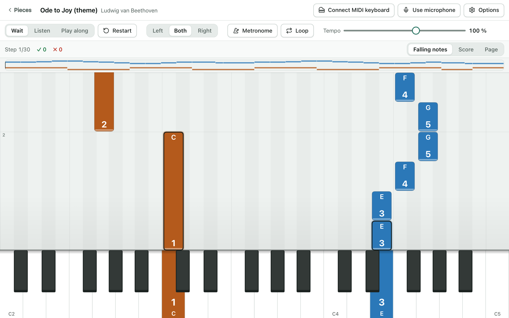

<div align="center">


# OpenTiles

**A free, open-source piano trainer that runs in your browser.**

Learn a piece with falling notes or sheet music, play it on a MIDI keyboard or an acoustic piano,
and get instant feedback. Practise in wait mode, play along at your own tempo, loop the hard bars
and track your progress. No account, no tracking, no payment. Ever.

[](https://github.com/KunalGehlot/OpenTiles/actions/workflows/ci.yml)
[](LICENSE)
[](https://github.com/KunalGehlot/OpenTiles/discussions)
[](CONTRIBUTING.md)


[User guide](docs/user-guide.md) · [FAQ](docs/faq.md) · [Documentation](docs/README.md) ·
[Discussions](https://github.com/KunalGehlot/OpenTiles/discussions) ·
[Contributing](CONTRIBUTING.md) · [Roadmap](PLAN.md)



</div>

> **Status (October 2026): working app, not yet released.** Practice in wait, listen and play-along
> modes with a MIDI keyboard (Chrome, Edge, Firefox), the microphone or the on-screen keys; falling
> notes and score views; a catalogue of 81 reviewed public-domain pieces; your own MusicXML, MuseScore,
> ABC and MIDI files; English and German. Before a public release: the microphone test on real pianos
> a legal review and the deployment.
> There is no hosted version to try yet; you can [run it yourself](#run-it-yourself) in a few minutes.
> See [PLAN.md](PLAN.md).

## Features

- **Three ways to practise.** _Wait_ stops at each chord until you play it, _Listen_ plays the piece
  to you, _Play along_ scores your timing as the piece moves on.
- **Falling notes, sheet music, or both.** Fingering numbers, a hand-coloured overview of the whole
  piece, and a keyboard that lights up what to press.
- **Practise the hard bits.** Left or right hand alone, loop any range of bars, slow the tempo down,
  transpose, turn on a metronome.
- **Play what you have.** A MIDI keyboard, an **acoustic piano through the microphone**, or the
  on-screen and computer keys.
- **Sight-reading drills.** Endless, generated flash-card practice for reading notes on the staff.
- **The Player.** Your whole library and the catalogue played like a self-playing grand piano, on
  your keyboard's own sound when one is connected, with the sustain pedal and phrasing, a queue and
  a music-stand view.
- **81 public-domain pieces**, from folk tunes to Bach and Beethoven, sorted into a five-level path.
  Every piece has a recorded source and a reviewer.
- **Bring your own music.** Import MusicXML, MuseScore, ABC or MIDI files, or even a recording of a
  piano. Your library never leaves your device.
- **Works offline.** Once loaded it keeps working without a connection, and you can install it as an app.
- **Private by design.** No account, no analytics, no cookies, no third-party requests.
- **Accessible.** High contrast, large print, reduced motion, left-handed layout, keyboard-only use.
- **English and German.**

<details>
<summary><b>More screenshots</b></summary>
<br>

|                                       Pick a piece                                        |                                          Falling notes                                          |
| :---------------------------------------------------------------------------------------: | :---------------------------------------------------------------------------------------------: |
|  |  |

</details>

## Browser support

OpenTiles is built for a computer with a MIDI keyboard or a piano in the room.

| Browser                | Status                                                                 |
| ---------------------- | ---------------------------------------------------------------------- |
| Chrome, Edge (desktop) | Supported, including MIDI keyboards                                    |
| Firefox (desktop)      | Supported, including MIDI keyboards                                    |
| Safari (macOS, iPadOS) | **Not supported.** It has no Web MIDI and the app does not work in it. |

Phones and tablets are not a target. An experimental iPad app is in the repository
([`apps/ios-shell`](apps/ios-shell/README.md)) but is unfinished and unreleased.

## Why

Commercial piano apps lock their whole learning experience behind subscriptions — including the
public-domain classics that make up much of their catalogue. OpenTiles makes the practice tool
itself free: interactive feedback, wait mode, looping, tempo control and progress tracking. The
music is either public domain or your own.

## Principles

| Principle                    | In practice                                                                      |
| ---------------------------- | -------------------------------------------------------------------------------- |
| Free forever                 | No paywall, ads or premium tier on any learning feature                          |
| Bring your own music         | Your library is private; the platform never shares or distributes your files     |
| Public-domain-only catalogue | Every catalogue piece is verified public domain or CC0, with provenance recorded |
| Runs in the browser          | A web app: nothing to install, and it keeps working offline once loaded          |
| Local-first and private      | Works offline; files stay on your device; optional sync is end-to-end encrypted  |
| Open by default              | AGPL-3.0 code, open formats (MusicXML, MIDI), CC0 catalogue metadata             |

## How it works

- **Inputs:** a MIDI keyboard (where the browser supports Web MIDI), the microphone for acoustic
  pianos, or the on-screen keyboard.
- **Score-informed listening:** the app always knows which notes come next, so the microphone only
  has to answer "are these notes sounding now?". That is what makes acoustic pianos work in a
  browser. The detector is written in Rust and runs as WebAssembly inside an AudioWorklet.
- **Your files, on your device:** MusicXML (`.musicxml`, `.xml`, `.mxl`), MuseScore, ABC and MIDI
  (`.mid`) files are converted in the browser and stored in your browser's private storage. Nothing
  is uploaded.

Read more in [docs/architecture.md](docs/architecture.md) and the full
[project specification](docs/spec/project-plan.md).

## Run it yourself

You need [Node.js](https://nodejs.org) ≥ 22.12, [pnpm](https://pnpm.io) 10 and
[Rust](https://rustup.rs) (stable, with the `wasm32-unknown-unknown` target, which
`rust-toolchain.toml` installs for you).

```sh
git clone https://github.com/KunalGehlot/OpenTiles.git
cd OpenTiles
pnpm install
pnpm build:engine   # compiles the note detector to WebAssembly
pnpm dev            # http://localhost:5173
```

Run the checks:

```sh
pnpm check                 # format, lint, typecheck, unit tests
cargo test --workspace     # engine tests, including the synthetic accuracy harness
python3 tools/pipeline/validate_catalogue.py
```

New to the code? The [development guide](docs/development.md) has the repository map, the rules
every change keeps, and how to run the end-to-end tests.

## Repository layout

| Path                  | Contents                                                        |
| --------------------- | --------------------------------------------------------------- |
| `apps/web`            | The web app (React + Vite, PWA)                                 |
| `apps/ios-shell`      | Experimental Capacitor wrapper for iPad (not released)          |
| `apps/sync-api`       | Optional server for end-to-end encrypted backup and sync        |
| `packages/engine`     | Rust note-detection engine → WebAssembly, with its AudioWorklet |
| `packages/song-model` | The `Song` model and MusicXML / MIDI parsers                    |
| `packages/practice`   | Practice engine: wait mode, play-along scoring                  |
| `packages/importers`  | Lazy-loaded heavy converters (MuseScore, recordings)            |
| `catalogue/`          | Public-domain scores and their provenance records               |
| `tools/pipeline`      | Catalogue validation and build scripts                          |
| `docs/`               | [Guides, specification and decision records](docs/README.md)    |

## Get help and get involved

- **Questions, ideas, or something you made with it?**
  [Start a discussion](https://github.com/KunalGehlot/OpenTiles/discussions).
- **Found a bug?** [Open an issue](https://github.com/KunalGehlot/OpenTiles/issues/new/choose) —
  there are forms for bugs, feature requests, microphone problems, translations and catalogue pieces.
- **Want to help?** Code, catalogue reviews, recordings for the detector test set and translations
  are all welcome. Start with [CONTRIBUTING.md](CONTRIBUTING.md) and look for
  [good first issues](https://github.com/KunalGehlot/OpenTiles/labels/good%20first%20issue).
- **Security problem?** Report it privately; see [SECURITY.md](SECURITY.md).

All participants follow the [Code of Conduct](CODE_OF_CONDUCT.md).

## Licence and credits

The code is [AGPL-3.0-or-later](LICENSE). The catalogue's metadata and the pipeline scripts are CC0;
every catalogue score is public domain or CC0 with its provenance recorded. OpenTiles was written
with an LLM under the maintainer's direction; [CREDITS.md](CREDITS.md) says how, and credits
[Sightread](https://github.com/sightread/sightread), the free piano app that came first.
