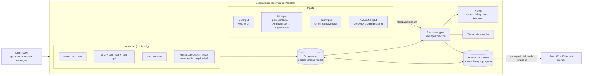

# Architecture

OpenTiles is a static, installable web app that does all music processing on the device. The
server side is only a CDN for the app and the public catalogue, plus (from phase 3) an optional
sync service that stores encrypted blobs it cannot read. See spec §6.

## Overview



Two seams keep the design simple:

- **Every input becomes the same stream of `NoteEvent`s.** Practice modes never know whether a
  note came from MIDI, the microphone or a tap.
- **Every file becomes the same `Song`.** The practice engine and views know one format.

## Packages

| Package                | Responsibility                                                                                                                      | Depends on              |
| ---------------------- | ----------------------------------------------------------------------------------------------------------------------------------- | ----------------------- |
| `packages/song-model`  | `Song` types, tempo map, shared Song builder, MusicXML, ABC and MIDI parsing, quantiser, hand split, transpose, difficulty estimate | `fflate` (unzip `.mxl`) |
| `packages/practice`    | `NoteEvent`, practice steps, `WaitMode`, `PlayAlongScorer`, tempo scaling                                                           | `song-model`            |
| `packages/engine`      | Rust detector compiled to `engine.wasm`; AudioWorklet processor and main-thread loader in `js/`                                     | —                       |
| `packages/importers`   | `importAnyScore` entry point; lazy-loaded converters: MuseScore (ADR 0005)                                                          | `song-model`, `fflate`  |
| `packages/sheet`       | Sheet-music PDFs: bars found from pdf.js's operator list or a page image, matched to a song's measures (ADR 0018)                   | `song-model`            |
| `packages/vault`       | Library key, Argon2id and recovery-code wrapping, record encryption, encrypted backup file                                          | `hash-wasm`, `fflate`   |
| `packages/sync-client` | Sync API client, key setup on the server, last-writer-wins sync engine                                                              | `vault`                 |
| `apps/web`             | React UI, canvas views, Web Audio, Web MIDI, IndexedDB, service worker                                                              | all of the above        |
| `apps/sync-api`        | Optional sync service (Node 22): sign-in, encrypted blobs, wrapped keys, crash reports                                              | —                       |

`song-model`, `practice`, `sheet`, `vault` and `sync-client` are DOM-free (ADR 0004, ADR 0006) so they run
in tests, web workers and the iOS shell unchanged.

## The `Song` model

Defined in `packages/song-model/src/types.ts` (ADR 0003).

- Musical time is in **quarter-note beats** from the start of the (unrolled) piece. Seconds are
  derived from the tempo map, so tempo changes and practice tempo scaling never touch note data.
- Each `SongNote` has `pitch` (MIDI number), `startBeat`, `durationBeats`, `hand`, `staff`,
  `voice`, optional `fingering` and `velocity`, the `measureIndex` it starts in, and a stable `id`.
  Tied notes are merged into one note; the original glyph references are kept in `sourceRefs` so the
  score view can colour every glyph of a tie.
- `measures` lists the playback order of bars after repeats are unrolled, each with its start beat,
  length and the original bar number.
- `tempoMap`, `timeSignatures` and `keySignatures` are beat-indexed event lists.
- `pedals` (P6-10, ADR 0020) lists the sustain, soft and sostenuto pedal changes in beats, with
  MIDI's 0–127 values; read from MIDI control changes and MusicXML pedal marks and sounds. In
  playback each note also gets a held length (how long the pedal makes it sound): this device's
  piano sounds notes that long, a MIDI keyboard gets the pedal as control changes instead.

## The practice engine

- `buildSteps(song, { hands })` groups notes that start together into **steps** (chords).
- `WaitMode` holds the cursor at a step until every expected pitch has been played; it reports
  correct and wrong notes so the UI can colour them.
- `PlayAlongScorer` matches `NoteEvent`s against expected onsets: ±75 ms on time, ±150 ms early or
  late, otherwise missed. Windows widen at slower practice tempos and shift by the measured input
  latency.
- The piece the session plays is prepared from the imported `Song` by `prepareSong`
  (`apps/web/src/practice/prepare.ts`): moved by octaves onto the learner's keyboard
  (`fitToKeyboard`, P4-07) and given suggested fingers (`withFingering`, P4-08). Note ids stay
  the same, so the score views link the written pitches while the session listens for the fitted
  ones. Changing either swaps the song in place (`PracticeSession.setSong`), keeping MIDI and
  microphone connected.
- Every run is recorded with `PerformanceRecorder` (key down and up, velocity). Inputs that report
  key release (MIDI, on-screen and computer keys) also get hold feedback from `judgeHold`. After a
  run the session renders it as played or polished for playback (ADR 0010).
- **One playback scheduler** (`playback.ts`, P6-03, ADR 0019) plays a song's notes for Listen,
  play-along's other hand and, later, the Player. `buildPlayback(song, { hands, accompany,
fromBeat, toBeat })` lists the notes (and, from P6-10, pedal events) in _song seconds_, the tempo
  map's seconds at 100 %. A `PlaybackCursor` maps them onto the caller's clock at a tempo factor:
  `take(until, now)` hands out what is due before the caller's look-ahead and skips notes more than
  50 ms late (pedal events are never skipped), `seek(seconds, at)` returns the notes that would
  already be sounding there with what is left of them and the pedals' positions, and
  `setTempo(factor, at)` re-anchors without a jump. Notes without a velocity of their own (MusicXML,
  ABC, the catalogue) get one from `touchVelocities` (P6-11): natural touch brings out the melody
  and the strong beats, "even" plays them alike (Settings → Practice → Touch). The `Song` never holds seconds. How far ahead to
  schedule is the caller's choice: the practice session hands notes over 0.3 s ahead, or as little
  as its instrument asks for (`Instrument.lookAhead`; 0.1 s for a MIDI output without `clear()`).

## The note-detection engine

The microphone path is the riskiest part of the project (spec §7, §13), so it is built first
(Phase 0).

```text
mic ─▶ AudioWorklet (128-sample blocks) ─▶ engine.wasm
          │                                    ├─ ring buffer
          │                                    ├─ 2048-pt FFT every hop (~5 ms) → spectral flux
          │                                    ├─ adaptive-threshold peak picking → onsets
          │  expected pitches ◀── main thread   ├─ at each onset, after a short settle delay:
          │                                    │    expected-note test (harmonic score of partials,
          │                                    │    piano inharmonicity, local noise floor, novelty)
          │                                    │    wrong-note test (±1, ±2 semitones, ±12)
          ▼                                    └─ events → NoteEvent { pitch, time, confidence }
     main thread (practice engine)
```

Design rules:

- **Score-informed, not a transcriber.** The detector is told which pitches are expected next and
  only tests those plus a short list of likely mistakes (±1, ±2 semitones, ±12).
- **Harmonic evidence.** For a candidate pitch, the first 8 partials (12 for bass notes) are
  predicted with piano inharmonicity `fₙ = n·f₀·√(1 + B·n²)` and looked up in the post-onset
  spectrum. Each partial is rated by `match × level × freshness`: how close the nearest peak is to
  the prediction, how far it stands above the local floor, and how much louder it is than the
  loudest of three frames just before the onset. A second view, the power-difference spectrum
  (post minus twice the pre-onset maximum), catches new partials hidden next to louder ringing
  ones under the pedal; each partial keeps the better of the two.
- **Odd partials decide octaves.** A pitch's score is the geometric mean of the evidence over all
  partials and over its odd partials, which the octave above cannot supply. Partials that another
  expected note explains count less. If the octave _below_ shows fresh odd-partial energy, it was
  played: it is reported as a wrong note and the expected note is not accepted at that onset.
- **Freshness, not presence.** A note still ringing under the sustain pedal, or brightening as its
  strings beat, has little fresh energy, so it is neither re-accepted nor mistaken for a wrong note.
- **Two resolutions.** Pitches below C3 are evaluated on a 4096-sample window 66 ms after the
  onset; everything else on 2048 samples 36 ms after it.
- **Per-mode thresholds.** Wait mode errs towards accepting; play-along towards precision.
- **No allocation on the audio path; no JS imports.** The wasm module exports a C ABI and is
  instantiated inside the AudioWorklet from a `WebAssembly.Module` compiled on the main thread
  (ADR 0002).
- **Two builds, chosen at runtime (P0-12).** `pnpm build:engine` makes `dist/engine.wasm`
  (baseline, no SIMD instructions) and `dist/engine-simd.wasm` (`--features simd`, which turns on
  RustFFT's wasm SIMD kernels, plus `-C target-feature=+simd128`). The app validates a tiny SIMD
  module (`wasmSimdSupported()`), downloads only the build that fits and falls back to the baseline
  if the SIMD build fails to load (`compileBestEngine`). `scripts/check-wasm.mjs` decodes both
  modules to prove the baseline has no SIMD instruction; a Vitest suite checks both builds make
  identical decisions on the same audio. `ot_build_features()` reports which build is running.

Speed per hop (`pnpm --filter @opentiles/engine bench`: a 20 s synthetic passage at 48 kHz, one
5.3 ms hop per call, fastest of five runs per hop; Node 22 on an x86-64 server core, at the time of
writing):

| Build              | Mean    | Median  | p99      | Slowest hop | Download (brotli) |
| ------------------ | ------- | ------- | -------- | ----------- | ----------------- |
| `engine.wasm`      | 14.3 µs | 12.0 µs | 151.3 µs | 308 µs      | 82 KiB            |
| `engine-simd.wasm` | 12.1 µs | 10.1 µs | 135.3 µs | 273 µs      | 139 KiB           |

SIMD saves about 15 % per hop. A V8 CPU profile of the baseline puts only about a third of a
hop in the FFT; most of the rest is per-sample and per-bin scalar work (ring buffer, window,
magnitudes and the `log10`/`ln` calls in the same loops), which SIMD barely helps yet. Both builds
are far inside the 2 ms budget on a desktop; the G0 check on an older iPad uses the Detector Lab
speed benchmark, which runs whichever build the browser picked.

Known weak spot: bass notes under heavy pedal (see the synthetic results below and P0-13).

Accuracy is measured by `cargo test` on a synthetic piano test set (smoke test) and by the
`evaluate` CLI on real recordings (gate). See [phase-0/test-set.md](phase-0/test-set.md).

Synthetic results at the time of writing (`cargo test --release -p opentiles-engine --test
synthetic_accuracy -- --nocapture`), single notes and 2–3 note chords between C2 and C7:

| Scenario                               | Correct notes accepted | Wrong notes accepted |
| -------------------------------------- | ---------------------- | -------------------- |
| Wait mode, no pedal, 48 kHz            | 98.3 %                 | 1.3 %                |
| Wait mode, heavy sustain pedal, 48 kHz | 87.8 %                 | 2.5 %                |
| Play-along mode, no pedal, 44.1 kHz    | 92.0 %                 | 0.2 %                |

Median decision latency is about 40 ms after the true onset (66 ms for notes below C3). These
numbers come from a synthesiser, not a piano in a room; the G0 gate is judged on real recordings.

## Score views

`apps/web/src/views/score/` draws the original MusicXML or ABC file with Verovio (LGPL-3.0,
lazy-loaded WebAssembly, precached for offline use; ADR 0009) in two layouts: a scrolling score
(one long system under a fixed cursor, P1-15) and a page view with page turns (P2-11), which is
the Sheet tab of a piece without a PDF of its own (P5-17). Each `Song`
note is linked to its glyph by source measure, onset and pitch (`glyph-map.ts`), so both passes of
a repeat share a glyph. `ScoreController` colours glyphs from `PracticeSession.marks` (expected,
correct, wrong, passed), moves the cursor from per-bar anchors (`cursor-map.ts`), turns pages and
marks the hardest bars after a run, all from `requestAnimationFrame`. Fingers the score does not draw itself
(ABC, and suggested ones) are added next to the note heads, suggested ones lighter. A MIDI piece has no
notation of its own, so its score is written from its song when the piece opens (`songToMusicXml` in
song-model, ADR 0017): every note in its own bar at its own onset and pitch, each written note carrying its
`sourceRefs` entry as its id, so the controller links that score by ref (`linkByRefs`) rather than by the
timemap. MIDI files from notation software are quantised in ticks so their triplets and short values survive
(`quantiseNotated`). Audio and MuseScore pieces keep the falling-notes view. In the scrolling layout the play bar
stays in the middle and the score moves past it by a transform (no scroll bar). Dragging it (or a sideways
trackpad scroll) scrubs: the beat drawn under the play bar (`beatAt`, the inverse of the cursor map)
becomes the position through `PracticeSession.seek`, so the score, cursor and falling notes move together;
a playing run pauses and Play starts from there (P4-18). A second after a run the whole display returns
to its start (ADR 0012). The falling notes are drawn from a steady clock
that follows the audio clock without its buffer-sized steps (`steadyClock`, ADR 0012).

## Design system

`apps/web/src/styles/` holds the whole look (ADR 0011). `tokens.css` defines every colour, size,
radius, shadow and duration once, in four colour sets: light, dark (`prefers-color-scheme`) and
high contrast in each (Settings → Accessibility, or `prefers-contrast: more`). `base.css` restyles
the native controls, `components.css` has the shared pieces (segmented control, switch, card,
panel, notice, badge, toast), `shell.css` the header, footer and full-height practice layout,
`pages.css` Home, Library, Settings and the text pages, and `practice.css` the practice screen and
its compact layouts. Components refer to token names, never to colours. Colours stay plain
`#rrggbb` / `rgba()` because the canvas reads them with `getComputedStyle` and cannot resolve
`var()` or `color-mix()` (`views/colour.ts` takes them apart). `test/tokens.test.ts` parses
`tokens.css` and checks the contrast of every text pair and mark in all four sets. Fonts are the
system fonts (nothing is downloaded); icons are `lucide-react`, drawn at the size of their text. The
CSS stays within what Safari 16.4 supports: no nesting, no `light-dark()`, no `popover` attribute.

The practice screen is a slim session header (back, title, MIDI, microphone, Options), a controls
row and a status row, then the canvas. Below 640 px wide or 520 px high the secondary buttons keep
only their icon (their names stay for screen readers). `PracticeRenderer` draws tiles, bar
numbers, shaded black-key lanes, a glossy keyboard and a short bloom on a played key. Gradients
are built once per resize, there is no `shadowBlur`, and the font is set only when it changes; frame
time on an older iPad has not been measured yet.

## Practice screen strips (P5-07)

Two optional strips sit above the falling notes. The live stats strip reads `status.live`, a
`LiveTally` the session feeds from its own judgements (play-along: on time is perfect, early or
late good; wait mode: right at the first try is perfect, after a wrong key good). The overview strip
(`apps/web/src/practice/OverviewStrip.tsx`) draws the piece's notes once as an SVG, moves its
position marker from `requestAnimationFrame` (not React), and sets loops and positions only through
`session.setLoop()` and `session.seek()`, like the loop controls and the canvas drag.

## Sight-reading drills (P5-05, ADR 0015)

`packages/practice/src/drills.ts` generates a drill from its options and a seed and writes it as
MusicXML. The practice screen loads `#/practice/drill/<options>.<seed>` like any MusicXML piece:
Verovio engraves the text and `parseMusicXml` makes the `Song` from the same text, so glyphs and
notes match. Drills show the page view, not the falling notes.
`PracticeSession.guide` (`full`, `keys`, `none`) decides what the canvas shows: drills hide the
falling notes and the keys to press unless the learner asks for the keys. Drills add practice time
(`recordPracticeTime`) but no progress record.

## Sheet music PDFs (P5-14, ADR 0018)

A library piece can keep the learner's own PDF (`LibraryItem.sheet`). The practice screen's Sheet
view (`apps/web/src/views/sheet/`, lazy-loaded with pdf.js) draws its pages and highlights the bar
being played. It sits under the Sheet tab, which shows the engraved page view for a piece without a
PDF (P5-17), so the switch is Falling notes | Score | Sheet. The remembered choice
(`settings.practiceView`) is one of those three; a stored `page` from before is read as `sheet`.
`packages/sheet` is pure: `drawingFromOperatorList` turns pdf.js's operator list into strokes and
outlines, `detectLayout` finds staves, systems, barlines, repeats, endings and note
heads per bar (a scanned page is read from its image instead, `drawingFromBitmap`), and
`alignSong` maps each played measure to a written bar, unrolling repeats with the song model's
`playbackOrder` and comparing notes per measure with heads per bar. The map is found once, in the
background, and saved on the item; "Adjust bars" corrects it, and a corrected map is kept. A
sheet-only piece (`format: 'pdf'`) opens as a reader. `SheetController` draws the pages lazily,
moves the highlight and cursor from `requestAnimationFrame` and scrolls to keep the bar in view.

## Storage

- **Private library:** IndexedDB via Dexie — original file bytes, the parsed `Song`, practice
  settings and progress. `navigator.storage.persist()` is requested on first import.
- **Rows and files** (P6-04, database version 2). A library piece is split in two under one id:
  its row in `library` (title, song, settings, tags, the sheet's name, size and bar map) and its
  bytes in `files` (the original file and the PDF). The Library page and the Player list rows only,
  so a library full of large PDFs lists as fast as an empty one; opening a piece, the backup and
  sync read the files too. `storage/library.ts` reads and writes whole pieces, both tables in one
  transaction. The upgrade from version 1 moves the bytes one piece at a time. The backup format
  and the sync records are unchanged, and the sync signature is computed from the row, so nothing
  is uploaded again after the upgrade.
- **The Player's transport** (P6-05, `player/transport.ts`, `player/browser.ts`). One transport
  for the app, so the music goes on between pages; practice, drills and the Detector Lab stop it.
  It keeps time on the page's clock (`performance.now()`), which runs whether or not sound has
  started; this device's piano gets the times converted to the audio clock through
  `getOutputTimestamp()`, a MIDI keyboard gets them as time stamps. A dedicated worker posts a
  tick every 25 ms, since a hidden tab stops animation frames and throttles the page's timers; on
  each tick notes are handed over about 120 ms ahead (less for a MIDI output without `clear()`),
  1.5 s while the page is hidden. The queue (`player/queue.ts`) shuffles so that every piece plays
  once per round.
- **The Player's collection** (`player/collection.ts`, `player/load.ts`) is the catalogue (verified
  pieces only in production) and the library rows in one list, with the last time each was played
  from `progress`. A library piece's length comes from its song; a catalogue piece's is remembered
  on this device (`device.catalogueSeconds`, kept out of backup and sync) the first time it loads,
  since working it out needs the full score reader.
- **Backup (phase 2):** an encrypted `.zip` the user keeps (`packages/vault`).
- **Sync (phase 3):** a random 256-bit library key, wrapped with an Argon2id-derived key from the
  user's passphrase and again with a printable recovery code; every record (including titles)
  encrypted with AES-GCM before upload. The server sees only account email, blob count and size,
  and timestamps. Details, deployment and the API: [sync.md](sync.md); decisions: ADR 0006.

## Safari and iPad rules

These come from spec §5. Every item must hold before G1. A ticked item is done in code and, where
a desktop browser can show it, covered by the Playwright suite; each one still gets checked on
real devices in the device lab before a release.

- [~] Create or resume the `AudioContext` only from a user tap (`unlockAudio()` in
  `apps/web/src/audio/context.ts`, P1-18). Left: a visible "Tap to start" state while audio is
  still locked.
- [x] Request the microphone with `echoCancellation: false`, `noiseSuppression: false`,
      `autoGainControl: false` (`packages/engine/js/mic-detector.ts`).
- [x] Feature-detect Web MIDI; never show a broken MIDI option on WebKit (`midiSupported()`; the
      practice bar says MIDI is not available instead).
- [x] Handle split view and rotation; keep practice usable at ⅓ iPad width (P1-27). Below 640 px
      wide or 520 px high the practice bars turn compact (one-row top bar, smaller controls that
      wrap, secondary hints hidden), the canvas takes the rest of the height, the on-screen
      keyboard never takes more than 40 % of it, and the canvas keeps clear of the home indicator
      and notch (`env(safe-area-inset-*)`). No page scrolls sideways at 320 px.
      `apps/web/e2e/layout.spec.ts` checks every page at 320 × 768, practice at 320 × 768, and
      resizing 1180 × 820 → 820 × 1180 → 375 × 820 → 820 × 375 with a key tap after each step.
      Still needs a real iPad: Split View and Slide Over at ⅓ and ½ width, Stage Manager windows,
      rotating mid-run, taps near the home indicator in a Home Screen app.
- [x] Ship a WebAssembly SIMD build and a non-SIMD fallback (P0-12): `engine-simd.wasm` where
      WebAssembly SIMD validates (Safari 16.4+), `engine.wasm` everywhere else.
- [x] Sound playback uses a Web Audio sampler (Salamander Grand Piano subset, P1-17, ADR 0007),
      never Web MIDI output; the additive synthesiser plays until the samples are loaded.
- [x] Request persistent storage on first import and prompt iPad users to Add to Home Screen
      (Safari can delete script-written data after seven days without a visit). `persist()` runs
      on first import and is never awaited (Firefox asks the user first, and the promise waits for
      the answer); the Library shows the hint after an import and the Home page shows a
      dismissible hint to iPad and iPhone users in a browser tab (dismissal kept in
      `localStorage`).
- [x] Keep the screen on while practising (P5-02, `apps/web/src/practice/wake-lock.ts`): a
      Screen Wake Lock held while a run plays and for five minutes after the last note, tap or key
      press, asked for again when the tab comes back, released on leaving the practice screen.
      Where a browser has no wake lock the screen sleeps as usual. Still needs a real iPad: Safari,
      a Home Screen app and the iPad app's web view.
- [x] Work fully offline after the first visit and install as an app (P1-23), see below. Still
      needs a real device: Add to Home Screen from Safari's Share menu, launch from the Home Screen
      in flight mode, and confirm the library is still there after more than seven days.
- [ ] Device lab before each release: older iPad (A12-class), current iPad, iPhone, Android tablet,
      low-end Windows laptop.

### Offline and installation

`vite-plugin-pwa` (Workbox `generateSW`, configured in `apps/web/vite.config.ts`) builds the web
app manifest and a service worker that precaches everything a practice session needs on the first
visit: the app shell, the engine `.wasm` and its AudioWorklet, the catalogue index and scores, and
the piano samples in `apps/web/public/samples/piano/`. The private library is in IndexedDB, not
in the cache. The worker takes control of the first page at once (`clientsClaim`) so a tab that
goes offline without reloading can still open catalogue pieces, but an update never activates by
itself: `apps/web/src/pwa/` shows a small "Update available" bar with Reload and Dismiss, so a
practice run is never interrupted. App icons are rendered from `public/icon.svg` by
`pnpm --filter @opentiles/web icons`; iOS uses the 180 px `apple-touch-icon.png`.

## iPad app (Capacitor shell)

`apps/ios-shell` wraps the built web app in Capacitor 8 and adds one native piece, the CoreMIDI
plugin in `apps/ios-shell/plugins/core-midi` (spec §5: no iOS browser has Web MIDI). The web app
detects the shell through the `window.Capacitor` global the native bridge injects
(`apps/web/src/lib/native-shell.ts`) and imports the plugin lazily, so browsers never load
Capacitor. `createMidiInput()` then returns `NativeMidiInput`, which maps CoreMIDI host-clock
timestamps onto `performance.now()` with NTP-style round trips and from there onto the audio
clock, like Web MIDI events. The app builds with Xcode 27 (October 2026) but has not yet run on a
device. Build steps, App Store and privacy-manifest notes:
[apps/ios-shell/README.md](../apps/ios-shell/README.md).

## MIDI in and out

- **In.** `createMidiInput()` returns `MidiInput` (Web MIDI) in browsers and `NativeMidiInput` (CoreMIDI)
  in the iPad app; both produce the same `NoteEvent`s. WebKit has no Web MIDI, so Safari and every iPad
  browser cannot read a keyboard; the practice screen says why (`midiUnavailableReason`). Firefox
  gates Web MIDI: it only sees devices connected when it started (no hot-plugging) and, off
  localhost, asks to install a site permission add-on; `describeMidiError` explains both. A MIDI
  timestamp more than a second from now is treated as "now", so a browser stamping events on another
  clock cannot push notes into the past.
- **Out and echo** (P4-19; "Plays on", P6-01; ADR 0019). `PracticeSession` plays through one
  `Instrument`; `playbackInstrument()` makes it this device's piano, a `MidiOutInstrument` (the
  keyboard's own sound, notes scheduled on the performance clock from audio-clock times) or both
  (`SplitInstrument`). The learner chooses with "Plays on" in the practice session bar or in
  Settings → MIDI keyboard. `playsOn()` (`audio/plays-on.ts`) works out where the notes really go:
  when the keyboard was chosen but MIDI is not connected, no keyboard is plugged in, it has no
  output, or several outputs leave the choice open, the notes play on this device and the screen
  says why; the button shows a warning. A new output moves the notes to it by itself. With "Play my
  MIDI keys on this device", `PracticeSession.midiEcho` sounds each MIDI note on this device until
  its key is released. The metronome and count-in always stay on this device. The iPad app has no
  MIDI out yet (P6-12).
- **Stopping cleanly** (P6-02). The practice screen keeps one `MidiOutInstrument` per output, which
  remembers every note it sent that may still sound or is stamped to start. `silence()` calls
  `clear()` where the browser has it, sends a note-off for each of those notes, then the sustain
  pedal up (CC 64 = 0) and All Notes Off (CC 123), so keyboards that ignore CC 123 stop too. It runs
  on Stop, a seek, a change of mode or hands, leaving practice, `pagehide`, and when the tab is
  hidden (a hidden tab draws no frames, so the run ends there). A note sent to an unplugged output
  is dropped instead of throwing in the drawing loop.
- **`MIDIOutput.clear()`** (checked 2026-10-17 on a Mac with a virtual CoreMIDI destination): Chrome
  and Edge have no `clear()`; Firefox has it. Chrome and Edge hold stamped messages and send each
  when it is due, so a note stamped up to the look-ahead (`SCHEDULE_AHEAD`, 0.3 s) before Stop can
  still start after it, followed by its own note-off; one started 58 ms after leaving the page.
  Nothing was left sounding 50 ms after Stop or `pagehide` in any of the three browsers. Where
  `clear()` is missing, the session therefore hands MIDI notes over at most 0.1 s ahead (P6-03).
- **"MIDI thru" keyboards** send what they receive back to the app. Settings' test note listens
  200 ms for its own copy and remembers such outputs (`settings.midi.thru`); practice then ignores
  input that matches a note it sent less than 50 ms before (`SentNotes`), so play-along does not
  score the app's accompaniment as the learner's notes.

## Languages

`apps/web/src/i18n/`: `t()` keyed by the English text, German in `de.ts`, a unit test that fails on any
string without German (ADR 0014). A first visit follows the browser's language.

Note names follow one setting (P5-03): letters, German (H for B, B for B♭) or Fixed-Do, or "as the
language" (German names in German). The settings store hands the style to `apps/web/src/lib/notes.ts`
the way it hands the language to `t()`, so the canvas, the Settings page, the library and the
microphone set-up all write a note the same way. Octaves are numbered from middle C = 4 in every
style. The Detector Lab keeps scientific names, and the score views show engraved notes only.
Black keys follow the key signature unless the learner chose sharps or flats (P5-04).

Transposing during practice (P5-04, `apps/web/src/practice/transpose.ts`) moves the `Song` with
`transpose()` before it is fitted and fingered, and asks Verovio to transpose the original file by
the same number of semitones, so the score's glyphs still match the song's notes by measure, onset
and pitch. The shift is limited to what keeps every note on an 88-key piano, so no note is dropped.

## Deviations from the spec's repository layout

- `packages/practice` was added for the practice engine (ADR 0004).
- `packages/vault`, `packages/sync-client` and `apps/sync-api` were added for the encrypted backup
  and sync (ADR 0006).
- `packages/engine` also holds the AudioWorklet processor and loader (`js/`) so the wasm module and
  the code that drives it are versioned together.
- `apps/ios-shell/plugins/core-midi` is a workspace package (`@opentiles/capacitor-core-midi`) so
  `cap sync` can link its Swift code and the web app can import its TypeScript definitions.
