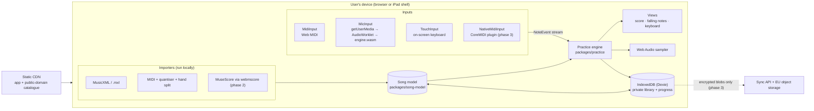

# Architecture

OpenTiles is a static, installable web app that does all music processing on the device. The
server side is only a CDN for the app and the public catalogue, plus (from phase 3) an optional
sync service that stores encrypted blobs it cannot read. See spec §6.

## Overview



Two seams keep the design simple:

- **Every input becomes the same stream of `NoteEvent`s.** Practice modes never know whether a
  note came from MIDI, the microphone or a tap.
- **Every file becomes the same `Song`.** The practice engine and views know one format.

## Packages

| Package | Responsibility | Depends on |
| --- | --- | --- |
| `packages/song-model` | `Song` types, tempo map, MusicXML and MIDI parsing, quantiser, hand split, transpose | `fflate` (unzip `.mxl`) |
| `packages/practice` | `NoteEvent`, practice steps, `WaitMode`, `PlayAlongScorer`, tempo scaling | `song-model` |
| `packages/engine` | Rust detector compiled to `engine.wasm`; AudioWorklet processor and main-thread loader in `js/` | — |
| `packages/importers` | Heavy, lazy-loaded converters (MuseScore, OMR, audio) — later phases | `song-model` |
| `apps/web` | React UI, canvas views, Web Audio, Web MIDI, IndexedDB, service worker | all of the above |

`song-model` and `practice` are DOM-free (ADR 0004) so they run in tests, web workers and the iOS
shell unchanged.

## The `Song` model

Defined in `packages/song-model/src/types.ts` (ADR 0003).

- Musical time is in **quarter-note beats** from the start of the (unrolled) piece. Seconds are
  derived from the tempo map, so tempo changes and practice tempo scaling never touch note data.
- Each `SongNote` has `pitch` (MIDI number), `startBeat`, `durationBeats`, `hand`, `staff`,
  `voice`, optional `fingering` and `velocity`, the `measureIndex` it starts in, and a stable `id`.
  Tied notes are merged into one note; the original glyph references are kept in `sourceRefs` so the
  score view can colour every glyph of a tie.
- `measures` lists the playback order of bars after repeats are unrolled, each with its start beat,
  length and the original bar number.
- `tempoMap`, `timeSignatures` and `keySignatures` are beat-indexed event lists.

## The practice engine

- `buildSteps(song, { hands })` groups notes that start together into **steps** (chords).
- `WaitMode` holds the cursor at a step until every expected pitch has been played; it reports
  correct and wrong notes so the UI can colour them.
- `PlayAlongScorer` matches `NoteEvent`s against expected onsets: ±75 ms on time, ±150 ms early or
  late, otherwise missed. Windows widen at slower practice tempos and shift by the measured input
  latency.

## The note-detection engine

The microphone path is the riskiest part of the project (spec §7, §13), so it is built first
(Phase 0).

```text
mic ─▶ AudioWorklet (128-sample blocks) ─▶ engine.wasm
          │                                    ├─ ring buffer
          │                                    ├─ 2048-pt FFT every hop (~5 ms) → spectral flux
          │                                    ├─ adaptive-threshold peak picking → onsets
          │  expected pitches ◀── main thread   ├─ at each onset, after a short settle delay:
          │                                    │    expected-note test (harmonic score of partials,
          │                                    │    piano inharmonicity, local noise floor, novelty)
          │                                    │    wrong-note test (±1, ±2 semitones, ±12)
          ▼                                    └─ events → NoteEvent { pitch, time, confidence }
     main thread (practice engine)
```

Design rules:

- **Score-informed, not a transcriber.** The detector is told which pitches are expected next and
  only tests those plus a short list of likely mistakes.
- **Harmonic score.** For a candidate pitch, the energy at its first 6–8 partials (with
  inharmonicity `fₙ = n·f₀·√(1 + B·n²)`) is compared with the local spectral floor. Odd partials are
  checked separately so an octave above or below cannot pass for the expected note.
- **Novelty.** A note must show new energy at its partials compared with just before the onset, so
  a note still ringing under the sustain pedal is not counted again.
- **Two resolutions.** Pitches below C3 are evaluated on a 4096-sample window (later decision);
  everything else on 2048 samples.
- **Per-mode thresholds.** Wait mode errs towards accepting; play-along towards precision.
- **No allocation on the audio path; no JS imports.** The wasm module exports a C ABI and is
  instantiated inside the AudioWorklet from a `WebAssembly.Module` compiled on the main thread
  (ADR 0002).

Accuracy is measured by `cargo test` on a synthetic piano test set (smoke test) and by the
`evaluate` CLI on real recordings (gate). See [phase-0/test-set.md](phase-0/test-set.md).

## Storage

- **Private library:** IndexedDB via Dexie — original file bytes, the parsed `Song`, practice
  settings and progress. `navigator.storage.persist()` is requested on first import.
- **Backup (phase 2):** an encrypted `.zip` the user keeps.
- **Sync (phase 3):** a random 256-bit library key, wrapped with an Argon2id-derived key from the
  user's passphrase; every record (including titles) encrypted with AES-GCM before upload. The
  server sees only account email, blob count and size, and timestamps.

## Safari and iPad rules

These come from spec §5. Every item must hold before G1.

- [ ] Create or resume the `AudioContext` only from a user tap; show a "Tap to start" state until
      then.
- [ ] Request the microphone with `echoCancellation: false`, `noiseSuppression: false`,
      `autoGainControl: false`.
- [ ] Feature-detect Web MIDI; never show a broken MIDI option on WebKit.
- [ ] Handle split view and rotation; keep practice usable at ⅓ iPad width.
- [ ] Ship a WebAssembly SIMD build and a non-SIMD fallback (P0-12).
- [ ] Sound playback uses a Web Audio sampler, never Web MIDI output.
- [ ] Request persistent storage on first import and prompt iPad users to Add to Home Screen
      (Safari can delete script-written data after seven days without a visit).
- [ ] Device lab before each release: older iPad (A12-class), current iPad, iPhone, Android tablet,
      low-end Windows laptop.

## Deviations from the spec's repository layout

- `packages/practice` was added for the practice engine (ADR 0004).
- `packages/engine` also holds the AudioWorklet processor and loader (`js/`) so the wasm module and
  the code that drives it are versioned together.
